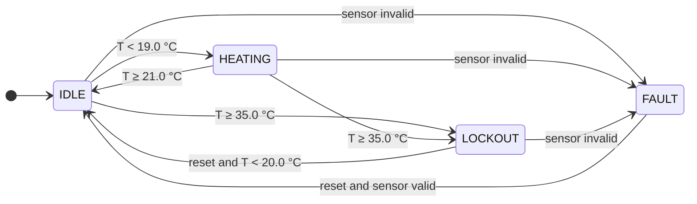

# Zephyr mutation testing demo

This demo consists of a thermostat state program (`src/thermo.c`), a ztest
suite, and a mutation engine (`mutate.py`) with pluggable mutation operators
that shows how much that coverage actually checks.

The mutation is driven by Python [tree-sitter](https://github.com/tree-sitter/py-tree-sitter).

```
src/thermo.c                SUT
src/thermo.h
src/test_thermo.c           test suite "thermo" + optional suite "thermo_improved"
Kconfig                     CONFIG_THERMO_TEST_IMPROVED switches the extra suite on
mutate.py                   CLI: build, run, classify, report
mutators/core.py            plugin API (MutationOperator, Edit) and the engine
mutators/operators/*.py     built-in operators, one class per file
plugins/enum_swap.py        example external operator, loaded with --plugin
```

## SUT Thermostat


## Run

From an environment where you can already build Zephyr (ZEPHYR_BASE set, or
the Zephyr CMake package exported with `west zephyr-export`):

```sh
pip install -r requirements.txt

python3 mutate.py operators                       # what's available
python3 mutate.py list                            # just show the mutants
python3 mutate.py run                             # original test suite

# improved test suite
python3 mutate.py run -b build-improved -- -DCONFIG_THERMO_TEST_IMPROVED=y

python3 mutate.py run -o ROR,TERM                 # only these operators
python3 mutate.py run -x SDL                      # all but these
python3 mutate.py run -p plugins/enum_swap.py     # add an external operator
python3 mutate.py run --fail-under 90             # exit 2 below 90% score
```

Without the Zephyr SDK installed, add `ZEPHYR_TOOLCHAIN_VARIANT=host` in front;
native_sim builds with the host gcc. The default board is
`native_sim/native/64` so no 32-bit multilib is needed; pass
`-B native_sim` if you prefer the default 32-bit target.

## CLI

| Command | Does |
|---|---|
| `operators` | table of registered operators (built-in plus any `-p` plugins) |
| `list` | table of the mutants that would be generated, nothing is built |
| `run` | builds and tests each mutant, then prints result tables and writes the report |

| Option | Commands | Default |
|---|---|---|
| `-a, --app DIR` | `list`, `run` | `.` |
| `-s, --source FILE` | `list`, `run` | `src/thermo.c` |
| `-o, --operators NAMES` | `list`, `run` | all on by default; comma-separated or repeated |
| `-x, --exclude NAMES` | `list`, `run` | none |
| `-p, --plugin FILE` | all | none; repeatable |
| `-B, --board` | `run` | `native_sim/native/64` |
| `-b, --build-dir DIR` | `run` | `build-mutation` |
| `-t, --timeout SECS` | `run` | `10` |
| `-r, --report FILE` | `run` | `mutation_report.md` |
| `--fail-under PCT` | `run` | off |
| `-- <cmake args>` | `run` | passed to the CMake configure step |

The build directory is configured once and then reused. If you change the
CMake args (such as adding `-DCONFIG_THERMO_TEST_IMPROVED=y`), use a different
`-b` directory or delete the old one.

## Workflow
The following steps illustrate what happens everytime the `mutate.py` is triggered:

1. tree-sitter parses `thermo.c`; only nodes inside function bodies are mutated.
2. Each enabled operator yields edits for the node types it registered for.
   Mutants are sorted by position and un-duplicated by resulting source.
3. The build is configured once with CMake. Each mutant is written in place,
   rebuilt incrementally with ninja, and `zephyr.exe` is run.
4. Classification:
   - `killed`: a ztest failed or the image crashed
   - `timeout`: the image hung, counted as killed
   - `survived`: everything still passed
   - `equivalent`: survived and the object file is identical to the original,
  so no test can ever kill it
   - `stillborn`: did not compile, left out of the score
5. The original source is always restored and rebuilt, even on Ctrl-C.

## Mutation operators

Each operator is a mutation rule. Most names follow the classic operator names
from mutation testing literature (Mothra, Proteum). `TERM` and `ECR` are names
specific to this demo.

| Name | Meaning | Module | Mutates |
|---|---|---|---|
| `ROR` | Relational Operator Replacement | `ror.py` | `<` → `<=`, `>=`; `>=` → `>`, `<`; `==` ↔ `!=` |
| `AOR` | Arithmetic Operator Replacement | `aor.py` | `+` ↔ `-`, `*` ↔ `/` |
| `LCR` | Logical Connector Replacement | `lcr.py` | `&&` ↔ `\|\|` |
| `TERM` | Term deletion (conditional operand deletion) | `term_deletion.py` | keep only one side of `&&` / `\|\|` |
| `UOD` | Unary Operator Deletion | `negation_removal.py` | `!x` → `x` |
| `BCR` | Boolean Constant Replacement | `bool_constant.py` | `true` ↔ `false` |
| `SDL` | Statement DeLetion | `statement_deletion.py` | delete a statement, `break` or declaration |
| `ECR` | Enum Constant Replacement | `plugins/enum_swap.py` | swap enum constants (`ST_*`); plugin, not built in |

### Mutant Interpretation
For the thermostat example.
#### ROR, Relational Operator Replacement
  Example: `temp >= T_OVERTEMP` → `temp > T_OVERTEMP`<br />
  A survivor means no test sits exactly on the boundary value.

#### AOR, Arithmetic Operator Replacement
  Example: `T_SETPOINT + T_HYST` → `T_SETPOINT - T_HYST`<br />
  A survivor means the result of the expression is not checked closely
  enough, e.g., nothing tests that the hysteresis band has the right width.

#### LCR, Logical Connector Replacement
  Example: `reset_btn && valid` → `reset_btn || valid`<br />
  A survivor means no test has the two conditions disagree.

#### TERM, Term deletion
  Example: `reset_btn && temp < T_SETPOINT` → `temp < T_SETPOINT`<br />
  A survivor means that condition could be deleted without any test noticing.

#### UOD, Unary Operator Deletion
  Example: `if (!valid)` → `if (valid)`<br />
  A survivor means the condition is never tested in both directions.

#### BCR, Boolean Constant Replacement
  Example: `return true;` → `return false;`<br />
  A survivor means no test checks the value the constant controls.

#### SDL, Statement DeLetion
  Example: delete `t->state = ST_FAULT;`, or delete the `break` after a
  `case`, so execution falls through into the next case.<br />
  A survivor means the statement's effect is never observed by any test.

#### ECR, Enum Constant Replacement
  Example: `t->state = ST_LOCKOUT;` → `t->state = ST_IDLE;`<br />
  A survivor means a wrong state transition would go undetected.

## Known Limitations

- Mutants run sequentially in one build directory. For speed, split them
  across several build directories, or use mutant schemata (compile all
  mutants in at once, select one at runtime).
- One source file at a time, mutated as text; no macro or constant mutation.
- Assumes the test image prints ztest's `PROJECT EXECUTION SUCCESSFUL`, so it
  works for native_sim. For real hardware you'd swap `run_tests()` for a
  flash-and-read-console step (Twister with `--device-testing` does this).
